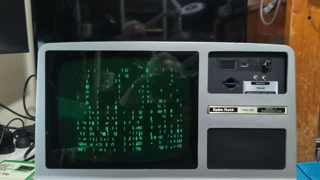

# Matrix Rain for the TRS-80 Model III

A series of **Matrix-style falling-code screensavers** for the **TRS-80 Model III**, written in **Z80 assembly** and accompanied by selected **BASIC** listings. Designed around a 48K Model III running **LDOS 5.1** with lowercase and special-character support.

The display is monochrome and character-based: 64 columns by 16 rows, video RAM at `3C00h`–`3FFFh`. Rather than reproducing modern colour and brightness effects, the programs use changing glyphs, variable-speed columns, gaps, and trailing characters to suggest the familiar digital rain.

## Video demonstration — running on the real Model III

[](media/TRS80_Model_III_Matrix_Demo.mp4)

**[▶ Watch the 9-second video demo (MP4)](media/TRS80_Model_III_Matrix_Demo.mp4)**

Recorded by **Roy Edmund Antaw** on his restored TRS-80 Model III. The original phone recording was converted to a compact, web-compatible H.264 MP4 (640 × 360, without audio) for convenient viewing and downloading from GitHub. Click the preview image or the video link to open it.

## Current version: MATRIXR6

**`bin/MATRIXR6.CMD`** is the latest build. It continues the progressive falling-space effect with a shorter blank interval:

- Normal, animated falling characters for an approximately random 5–10 seconds.
- **Progressive blank rain** for approximately **one second** (38 animation frames): moving streams replace only the characters they touch with **spaces**, so existing code is erased gradually, not all at once.
- Returns to normal rain and repeats automatically; falling-column state continues progressing during the blank phase.

Timing is approximate because it is tied to animation frames, not a real-time clock.

**Character restrictions:** the later builds deliberately do not draw code `191` (full block) or ASCII `46` (`.`), `58` (`:`), or `59` (`;`). Code `32` (space) is used for gaps, erasure and the invisible phase. Character appearance also depends on the fitted ROM and active character bank.

## BASIC port of MATRIXR6

Prefer interpreted BASIC? The [**MATRIXR6.BAS listing**](basic/MATRIXR6.BAS) recreates the latest Z80 release using standard Model III/LDOS BASIC, including the extended ROM glyphs, individually moving streams, **roughly one second of falling SPACE characters** and no full-screen clear at the phase change.

The BASIC version reads the Model III system seconds and interrupt countdown (`PEEK(16919)` and `PEEK(16918)`) for approximate wall-clock timing: **5–10 seconds of visible rain, then about one second of progressive blank rain**. It is significantly slower than the Z80 executable. As a text listing, the `.BAS` file is **not yet a tokenised LDOS BASIC program**—enter the numbered lines or import/convert the text using a compatible disk-image utility. Type `RUN` within BASIC to start, and press any key to exit.

See [BASIC instructions](docs/INSTALL.md#basic-version) and the [assembly source](src/MATRIXR6.ASM). Timing and glyph appearance depend on your Model III and selected character ROM; the BASIC listing has not yet been tested on physical hardware.

## Running on a Model III

1. Import `bin/MATRIXR6.CMD` into a TRS-80-compatible disk image or onto a physical disk as **`MATRIXR6/CMD`**. A `.CMD` on your modern PC is **not itself a TRS-80 disk image**.
2. Boot your compatible disk operating system (tested by the creator with earlier versions on **LDOS 5.1**).
3. At `LDOS READY`, type:

   ```text
   MATRIXR6
   ```

4. Release `ENTER`, then press **any key** to clear the screen and return to DOS.

The `.CMD` files load at `6000h`, draw to `3C00h`–`3FFFh`, poll the keyboard at `38FFh`, and use DOS return address `402Dh`. They do not intentionally write to the disk.

## Repository contents

| Folder | Contents |
|---|---|
| `bin/` | Pre-assembled TRS-80 `.CMD` executables |
| `src/` | Editable Z80 assembly source |
| `basic/` | Interpreted BASIC listings where available; plain text, not tokenised disk BASIC files |
| `docs/` | Version notes, setup guidance and original per-version notes |
| `tools/` | Small, self-contained Python assembler/build helper for these source files |

## Versions

| Program | Features |
|---|---|
| `MATRIX3` | Original falling columns; uppercase text, solid head, punctuation fading |
| `MATRIXFX` | Expanded use of lowercase, special and semigraphics characters |
| `MATRIXF2` | Removes full-block, dot, colon and semicolon characters |
| `MATRIXR3` | Layered streams; per-column speeds; more natural flow and gaps |
| `MATRIXR4` | MATRIXR3 with timed invisible rain; clears screen instantly at phase transition |
| `MATRIXR5` | Progressive blank rain for a random 5–10 seconds |
| **`MATRIXR6`** | Identical progressive space rain but shortened to about 1 second; normal rain remains random 5–10 seconds |

See [docs/VERSIONS.md](docs/VERSIONS.md) for detail.

## Rebuilding

Python 3 is sufficient; no third-party package is needed:

```sh
python3 tools/build.py
```

This assembles the seven sources into `build/` and checks each generated binary against the corresponding file in `bin/`.

## Compatibility and testing

The original MATRIX3 machine-code build was tested in software, and the earlier `MATRIX3` and `MATRIXFX` variants have been reported working on a physical Model III. The later assemblies have been checked for valid `.CMD` framing and reproducible compilation, but **MATRIXR6 has not yet been tested on physical hardware**. As with other retro-computing tools, keep original disks protected and try software on a copy.

## References

- [TRS-80 character set](https://en.wikipedia.org/wiki/TRS-80_character_set)
- [Falling code visual reference](https://www.youtube.com/watch?v=liFjsSDj1eM)
- [Alternative rain visual reference](https://www.youtube.com/watch?v=95rAM5LkZ2w)

This project is an original retro-computing recreation, not an official production or an adaptation of proprietary screensaver source code.

## Credits and acknowledgements

- **Roy Edmund Antaw** — project creator, TRS-80 Model III restoration, hardware testing, visual direction, and iterative feature feedback.
- **ChatGPT (OpenAI)** — AI-assisted design and implementation of the Z80 assembly screensavers, BASIC listings, build tooling, and project documentation, developed collaboratively with Roy. The generated code should be tested and reviewed as with any other contributed code.

Thanks to the TRS-80 community and the creators of the original Matrix digital-rain aesthetic for inspiration. This project is an unofficial homage, not affiliated with the movie or its rights holders.

## Licensing

Licensed under the **GNU General Public License v3.0**, as provided in this GitHub repository's existing [LICENSE](LICENSE). Contributions should be compatible with GPL-3.0.
